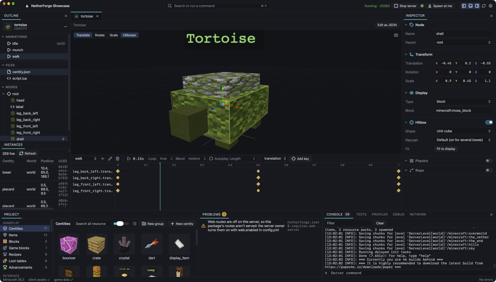

  

<h1 align="center">NetherForge</h1>

  <strong>A game-engine-style editor for Minecraft server content.</strong> 
  Scripted entities, menus, items, worlds and whole server networks, 
  running on a real Paper server and hot-reloaded on every save.

  <a href="../../releases/latest">Download</a> ·
  <a href="docs/guide/index.md">Documentation</a> ·
  <a href="docs/reference/index.md">Lua API</a> ·
  <a href=".github/CONTRIBUTING.md">Contributing</a>

---

  

NetherForge is a desktop editor plus the Paper plugin that runs what you make
with it. You build **centities** (entities made of block, item and text
displays that animate, collide, can be clicked and run Lua), server-wide Lua
**modules**, **menus**, **dialogs**, **items** and **blocks**, **worlds**,
and **resource packs**. Press **Start server** and the editor runs a local
Paper server with your project loaded; save a file and it's reloaded in game
within a second, without a restart.

## Features

- **Your project is a folder of plain files.** One canonical JSON form, Lua in
  `.lua` files, ids that are folder names. Version it with git, review it in
  pull requests, merge two people's work cleanly, and edit it in any editor or
  with a coding agent.
- **Real Minecraft is the preview.** The editor finds or downloads Java,
  downloads Paper for your project's Minecraft version, installs the plugin
  and streams the console. There's no simulator to drift from the game.
- **Hot reload per resource.** Saving a file reloads just what changed, and a
  centity's live instances move onto the new definition in place; saving a
  module restarts it and whatever required it. Problems and script errors
  come back with the file and line.
- **An editor for every kind of content**:
  - **Centities**: node tree, inspector, 3D viewport with gizmos, an animation
    timeline, hitboxes fitted to block models, and rigid-body physics.
  - **Menus and dialogs**: chest windows with skinned backgrounds, and dialog
    screens with questions and buttons.
  - **Items and gameplay**: items, blocks, recipes, loot tables, buffs,
    advancements and mining rules for the game's own blocks.
  - **Effects**: particle effects on a timeline, cutscenes that move the
    camera, and screens, fonts and videos drawn on maps.
  - **Worlds**: terrain with a live map preview, biomes, skies, dimension
    types, datapacks, saved maps and structures.
  - **Resource packs**: pictures, glyphs for text, item and block looks,
    tooltips and sounds, built into one pack and sent to players.
- **Lua 5.4, sandboxed**, with an instruction budget per call and memory and
  time limits. Events on the things they're about (`this:on("click", ...)`),
  tasks that wait (`nf.wait`, `dialog:ask`), typed commands, schedules, saved
  data and SQL databases, the world, entities, players and real inventories,
  HTTP and web routes, WebAssembly, Vault and PlaceholderAPI. Completions and
  docs as you type, a debugger, a profiler, and tests that run on a real
  server with fake players.
- **Packages and workspaces.** Use another project as a package, from a folder
  or a git repository, pinned by a lock file. A workspace keeps several
  projects together.
- **Server networks.** A Velocity plugin links a network's servers: channels,
  requests, shared maps, who's online where, and sending players between
  servers. The editor runs a whole dev network.
- **Coding agents and CI.** Every project comes with `AGENTS.md` and docs for
  agents, the editor serves an MCP server that can reload, read the console
  and play the game with fake players, and the `netherforge` command checks,
  formats and tests a project anywhere.
- **Deploying is pointing a server at the folder.** Put the plugin jar in
  `plugins/`, set `project:` in its `config.yml`, and `git pull` +
  `/nf reload` to update.
- **Minecraft 1.21.11 and every 26.x**, on Paper, with one plugin jar per
  version.
- **macOS, Windows and Linux**, tested equally.
- **No Minecraft assets shipped.** The editor reads textures and models from
  your own Minecraft install; the plugin asks the server.
- **Open source**, Apache-2.0: the editor, the file-format library, the plugin
  and the command.

## Download

Get the latest release from the [releases page](../../releases/latest):

| OS      | Download                                        |
| ------- | ----------------------------------------------- |
| macOS   | `NetherForge_<version>_universal.dmg`           |
| Windows | `NetherForge_<version>_x64-setup.exe` or `.msi` |
| Linux   | `.AppImage`, `.deb` or `.rpm`                   |
| Server  | `NetherForge-<version>-paper-<minecraft>.jar`   |
| Proxy   | `NetherForge-<version>-velocity.jar`            |

The `netherforge` command is on npm as
[`@netherforge/cli`](https://www.npmjs.com/package/@netherforge/cli):
`npx @netherforge/cli setup` sets up a fresh clone for VS Code, Neovim or a
coding agent (the JSON Schemas, LuaLS stubs and docs the editor would write),
and `check`, `format` and `test` run in CI. See
[Editing outside the editor](docs/guide/external-editors.md).

## Quick start

1. Install the editor and open it.
2. **Create project…**: pick a name, the Minecraft version and an empty
   folder.
3. Add a centity in the sidebar, give its root node a block, and save.
4. **Start server**, accept the Minecraft EULA, and join `localhost` from
   Minecraft (same version).
5. `op` yourself from the editor's console, then `/nf spawn <your centity>`
   in game, or press **Spawn at me**.
6. Change something and save. Watch it update in front of you.

The [getting started guide](docs/guide/index.md) walks through this with a
first script, and [deploying](docs/guide/deploying.md) covers running a
project on a real server.

## Documentation

The docs live in [`docs/`](docs/) and are published as a site by
[`docs.yml`](.github/workflows/docs.yml):

- [Guides](docs/guide/index.md): getting started, centities and animation,
  physics, particles, cutscenes, screens, menus, dialogs, items, blocks,
  resource packs, world generation, scripting, web services, WebAssembly,
  server networks, testing and debugging, packages and workspaces, git,
  deploying, other editors and coding agents.
- [File format](docs/format/project.md): the specification of everything in a
  project.
- [Lua API reference](docs/reference/index.md): generated from the API spec in
  [`packages/api/`](packages/api/).

## Contributing

Contributions are welcome. [CONTRIBUTING.md](.github/CONTRIBUTING.md) gets you from a
clone to a passing test run on any OS, and [AGENTS.md](AGENTS.md) maps the
repository and its rules (for people and coding agents alike). Changes are
recorded in the [changelog](CHANGELOG.md). To report a vulnerability, see
[SECURITY.md](.github/SECURITY.md).

## License

[Apache License 2.0](LICENSE).

NetherForge is not an official Minecraft product, and is not approved by or
associated with Mojang or Microsoft. Minecraft is a trademark of Mojang
Studios. NetherForge ships no Minecraft assets: it reads them from your own
installation.
